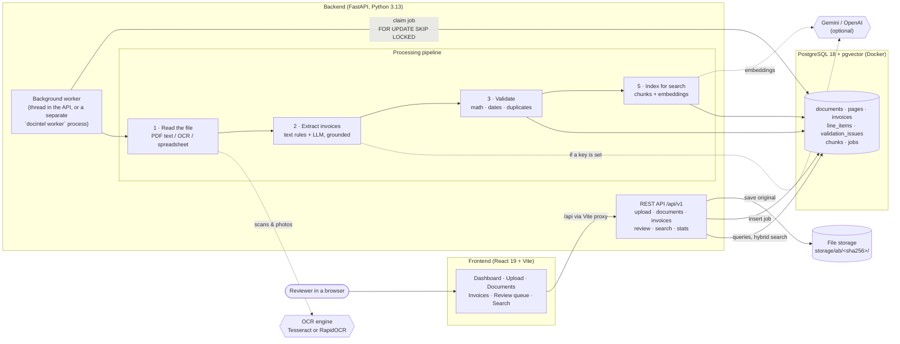
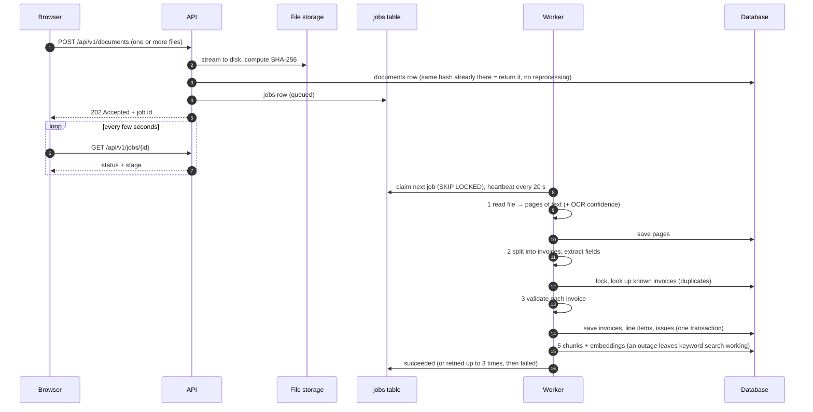
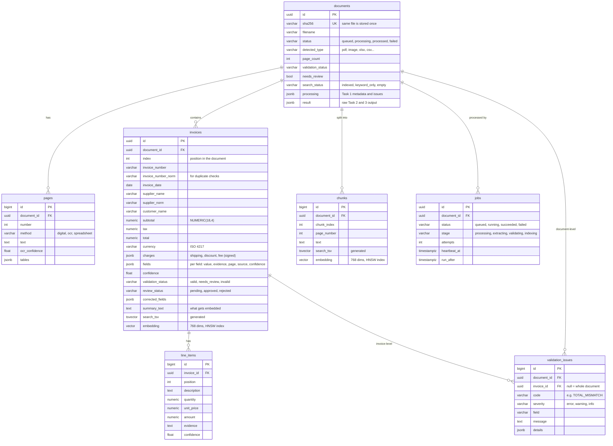

# Architecture

DocIntel turns invoices in any common format (PDF, scans, phone photos, PNG/TIFF, Excel, CSV) into checked, searchable records. A person reviews only the invoices that need it.

The diagrams are [Mermaid](https://mermaid.js.org/); GitHub and VS Code render them directly.

## System overview

## What happens to one upload

A worker that dies mid-job stops sending heartbeats, so `requeue_stale` puts its job back in the queue. Several workers can run at once: `SKIP LOCKED` makes sure each job is claimed by exactly one of them.

## The pipeline, stage by stage

### 1 · Document processing (`src/docintel/processing`)

| Input | How it is read |
|---|---|
| Digital PDF | PyMuPDF text layer, in reading order. Soft hyphens and Unicode minus signs are turned into `-`, so invoice numbers and negative amounts survive. |
| Scanned PDF / mixed PDF | Each page without usable text is rendered at 300 dpi and OCR'd. Digital pages keep their text. |
| Photo / PNG / JPEG / TIFF (multi-page, 16-bit, transparent) | OpenCV clean-up (deskew, sideways/upside-down rotation, upscaling of low-resolution images, a stronger clean-up pass for noisy ones), then OCR. |
| XLSX / XLS / CSV / TSV | Read cell by cell with no OCR. Detects the encoding (UTF-8, cp1252, UTF-16) and the delimiter, and reads files with the wrong extension correctly (e.g. TSV saved as `.xls`). |
| Broken files | The file type is detected from its content, not its name. Damaged, password-protected, empty or unsupported files get a `failed` status with a reason; nothing crashes. Repaired or truncated PDFs are processed but flagged, so their invoices always go to review. |

OCR uses Tesseract when it is installed, otherwise RapidOCR (pip-only, ONNX). Every OCR page records its confidence.

### 2 · Extraction (`src/docintel/extraction`)

1. **Split** the document into invoices. A new invoice number, or a `Page 1 / n` footer, starts a new invoice. A 1,130-page batch file becomes 835 invoices.
2. **Text rules** (regular expressions over labelled lines and tables) read the invoice number, dates, parties, subtotal, tax, total, currency, line items, and charges such as shipping, discounts and fees.
3. **LLM** (Gemini `gemini-3.5-flash` or OpenAI) reads the same text and returns JSON that matches a fixed schema.
4. **Grounding**: each LLM value must be found in the page text, or it is discarded. This blocks invented numbers.
5. **Merge and score**:

   | Outcome | Confidence |
   |---|---|
   | Rules and LLM agree | 0.97 |
   | LLM only | 0.88 |
   | Rules only | 0.78 |
   | They disagree | 0.55, flagged for review |

   Amounts are `Decimal` and never `float`. They are normalised from `1.234,56`, `1,234.56`, `1'234.56`, `-$24.71`, `৳`, `Tk` and `Rs`.
6. **Spreadsheets** are mapped by their column headers and need no LLM.

Without an API key, or once the free quota is used up, extraction continues with rules only and says so in the invoice's notes. Per-minute rate limits are waited out; a daily limit switches to rules only.

### 3 · Validation (`src/docintel/validation`)

Validation is plain code with no AI, so every verdict can be explained:

- **Required fields:** invoice number, date, supplier and total are present.
- **Arithmetic** (exact decimals, ±0.01 tolerance, configurable):
  - subtotal + charges + tax = total;
  - quantity × unit price = amount on every line;
  - the lines add up to the subtotal.
- **Dates:** the date parses; it is not in the future and not implausibly old; an ambiguous day/month order (03/04) is flagged.
- **Other checks:** currency code, tax rate (at most 30%), tax not above total, negative amounts outside credit notes, supplier ≠ customer, low OCR quality, and rules/LLM disagreements.
- **Duplicates:** same supplier and invoice number across *all* stored documents (`DUPLICATE_INVOICE`), and a reissued number with a different total (`DUPLICATE_NUMBER_CONFLICT`). An advisory lock makes two workers check duplicates one at a time.

| Status | Rule |
|---|---|
| `invalid` | any error |
| `needs_review` | any warning, low confidence, or a damaged source file |
| `valid` | none of the above |

### 4 · API and review (`src/docintel/api`)

The API is FastAPI with OpenAPI docs at `/docs`. A reviewer can correct fields (validation runs again immediately), and approve or reject. Approving an invoice that still has errors needs `force=true`.

Optional `X-API-Key` protection is off by default. Uploads are capped at 50 MB, and filenames are sanitised before storage.

### 5 · Search (`src/docintel/search`)

Search is hybrid: three rankings merged with Reciprocal Rank Fusion (k = 60).

| Ranking | What it is good at |
|---|---|
| **Semantic**: pgvector HNSW, cosine, `gemini-embedding-001`, 768 dimensions | "computer screens" finds invoices for a *27" IPS Monitor* |
| **Full-text**: PostgreSQL `tsvector` | exact words |
| **Exact / fuzzy**: normalised invoice number and `pg_trgm` supplier similarity | `INV 2024/43` finds `INV-2024-0043`; "Mueller" finds "Müller" |

Each invoice is embedded as one sentence: number, supplier, customer, date, total and item names. Page text is embedded in overlapping chunks of 1,200 characters. Every vector records the model that made it, so changing the model never mixes vectors from different models. Without an embedding key, an offline lexical embedder is used so the system still runs.

## Database schema

The full DDL, exported from the running database, is in [`schema.sql`](schema.sql). The model definitions are in `src/docintel/db/models.py`.

**Design choices:**

- **Typed columns for the facts you filter on, JSONB for the detail.**
  - Typed: dates, `NUMERIC` amounts, normalised supplier and number. Filtering, sorting, totals and duplicate checks run on these.
  - JSONB: per-field evidence and confidence, charges, and the raw machine output. The review screen needs these, but nothing queries inside them.
- **Indexes:**
  - B-tree: status, dates, totals and normalised keys;
  - GIN: full-text, plus trigram on supplier;
  - HNSW: both embedding columns;
  - a claim index on `jobs (status, run_after)`.
- **Cascade deletes:** deleting a document removes everything derived from it.
- **The queue lives in Postgres:** no Redis or RabbitMQ to run. `SKIP LOCKED` and heartbeats give at-least-once processing with retries.

## Technology choices

| Need | Choice | Why |
|---|---|---|
| API | FastAPI | typed request and response models, OpenAPI docs for free |
| Database and vectors | PostgreSQL 18 + pgvector | one system for records, full-text, fuzzy and vector search, and the job queue |
| PDF | PyMuPDF | fast; text in reading order; renders pages for OCR |
| OCR | Tesseract / RapidOCR | Tesseract when installed; RapidOCR installs with pip alone (no admin rights needed) |
| LLM | Gemini 3.5 Flash (OpenAI supported) | structured JSON output; free tier available |
| Embeddings | `gemini-embedding-001` | measured better than `gemini-embedding-2` on these invoices: right invoice first in 6/6 test queries vs 4/6 |
| Frontend | React 19, Vite, TypeScript, Tailwind, TanStack Query | live job progress through polling; filters kept in the URL |

## Known limits

- **Free-tier AI quota.**
  - **Extraction:** Gemini allows 20 requests a day. Beyond that, extraction is rules only, which handles known layouts (91% field accuracy) but not new ones.
  - **Embeddings:** Gemini allows 1,000 texts a day, so a file of 1,000+ pages needs several days to index for semantic search. Until then it is searchable by keyword.
- **Schema changes:** handled by `UPGRADE_SQL` in `init_db`. A production deployment would use Alembic.
- **Single machine:** API, worker and database run on one machine. Scaling out means more `docintel worker` processes against the same database; files would then need shared storage such as S3.
